docker compose up
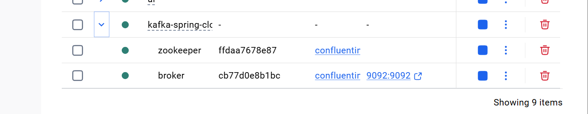

broker
docker exec --interactive --tty broker kafka-console-consumer --bootstrap-server broker:9092 --topic R2
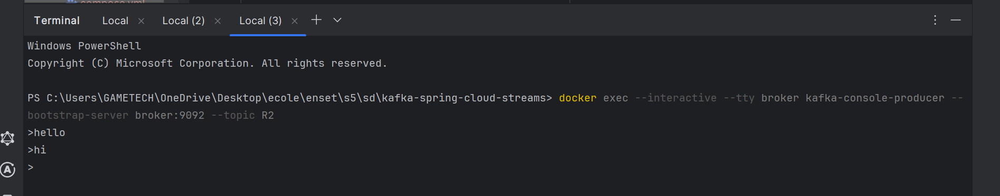

kafka consumer
docker exec --interactive --tty broker kafka-console-producer --bootstrap-server broker:9092 --topic R2
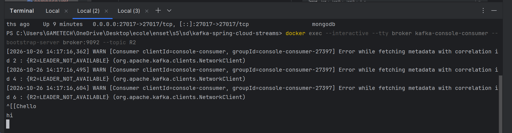

consumer from beginning
docker exec --interactive --tty broker kafka-console-producer --bootstrap-server broker:9092 --topic R2 --from-beginning
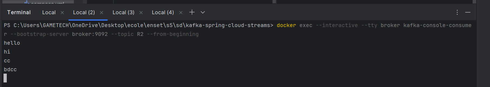

controller 
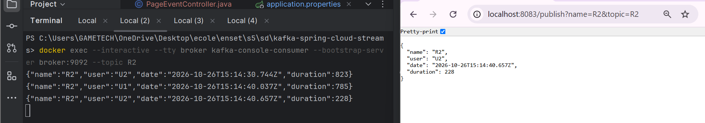

handlers
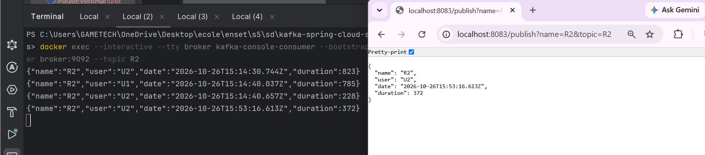
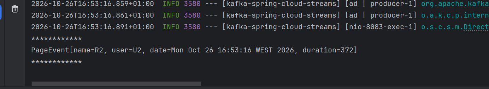

supplier
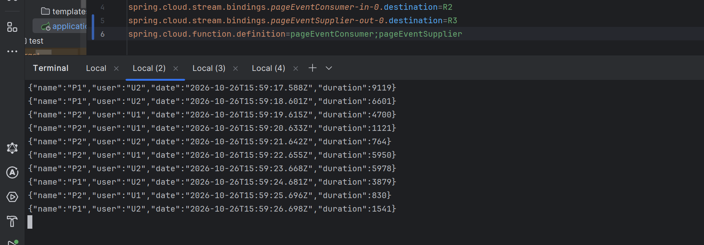

kstream
R3
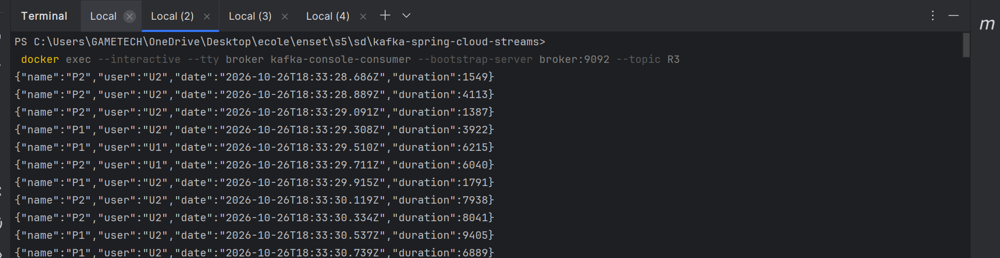
R4
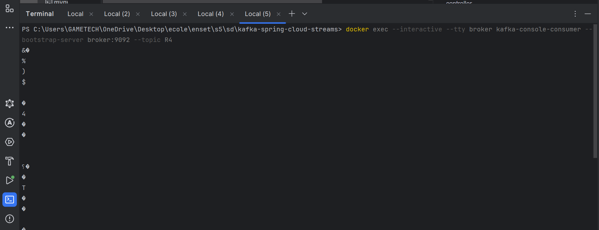

kafaka console consumer
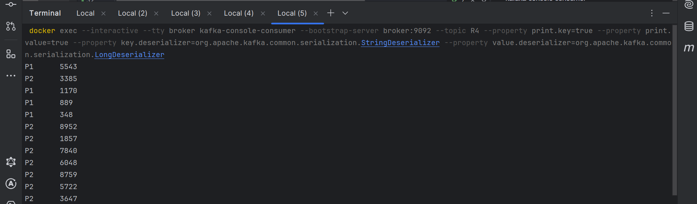

groupbykey
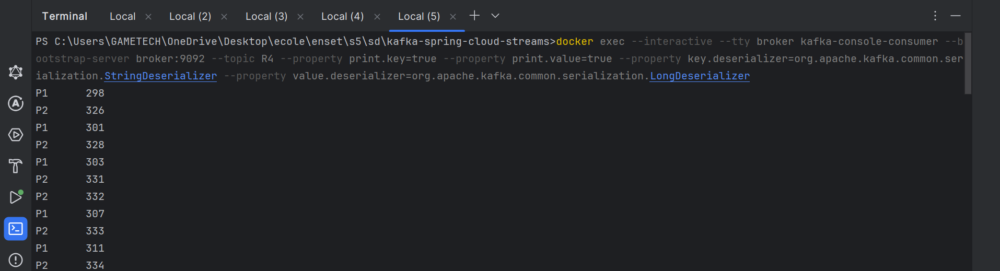

windowedBy
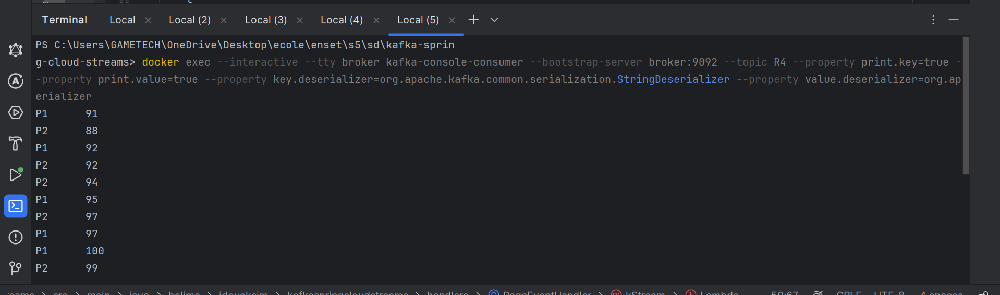

analytics
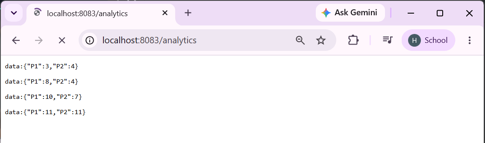

visualisation
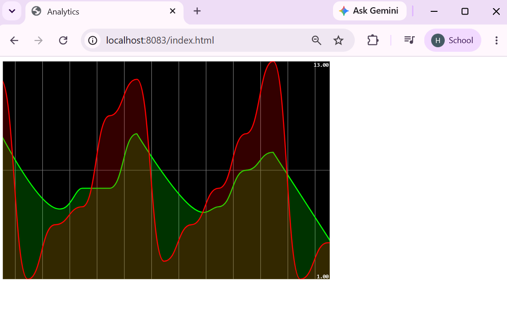

